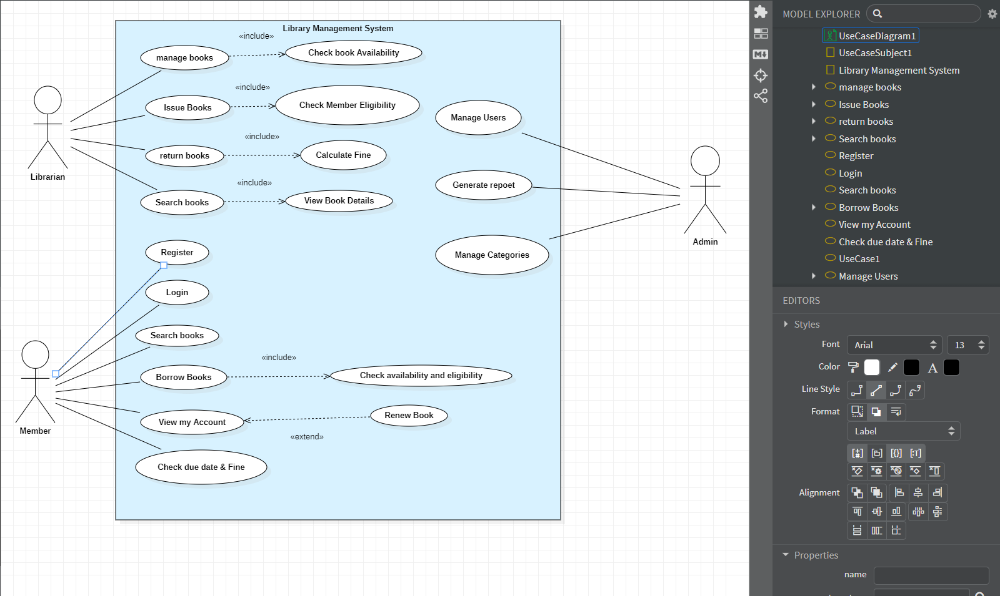
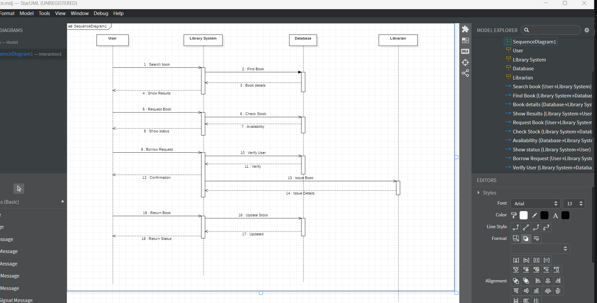
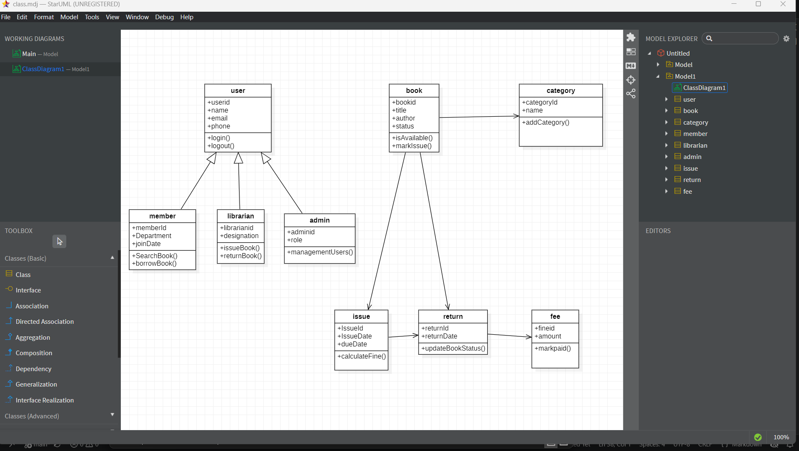
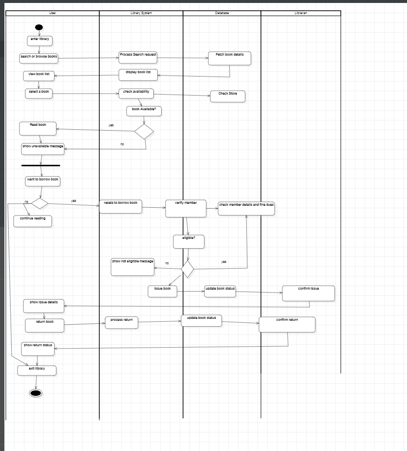
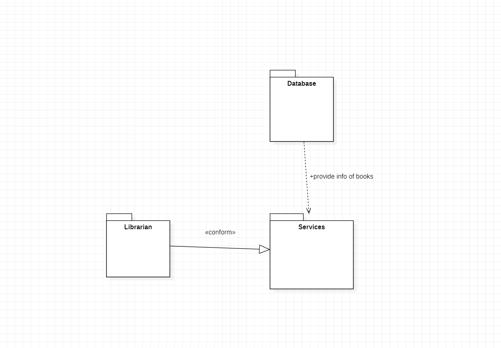
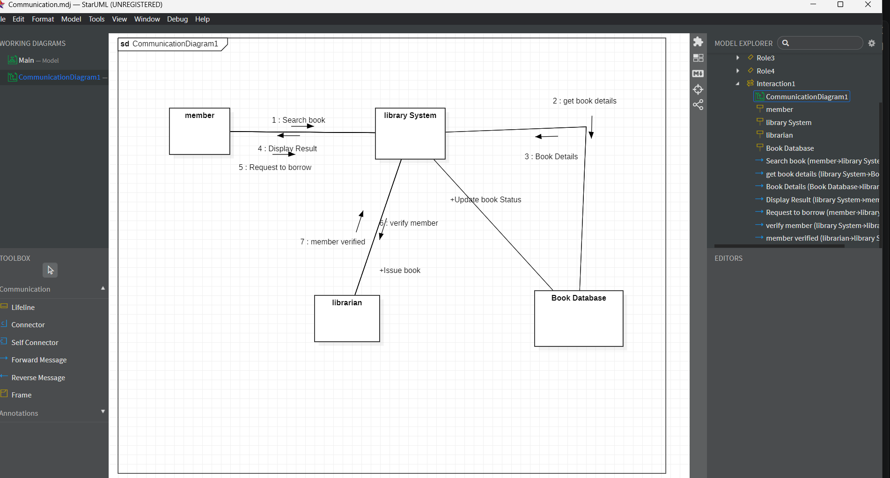

# Library_Management
# Exp - 2 LIBRARY MANAGEMENT SYSTEM

# AIM:

To draw a UML diagram for a library management system.

# SRS (Procedure):
**Actors Used-:**
1) Librarian
2) Student
3) Staff
4) Admin

**Software - StarUML**

**List of Diagrams -:**
1) Class Diagram
2) Usecase Diagram
3) Package Diagram
4) Activity Diagram
5) Communication Diagram
6) Sequence Diagram

**Procedure-:**
1. Define System Requirements: Outline the functional and non-functional requirements, such as user authentication and transaction processing.
2. Identify Key Actors and Use Cases: Determine actors and define their interactions.
3. Design the System Architecture: Break down the system into components
4. Create UML Diagrams: Develop use case, class, sequence, and activity diagrams based on the system design.
5. Test and Validate: Perform testing to ensure the system meets functional requirements and security standards.

# DIAGRAMS:
# Use Case Diagram

# Sequence Diagram

# Class Diagram

# Activity Diagram

# Package Diagram

# Communication Diagram

# RESULT:
Thus, the UML Diagrams for a Library Management System has been drawn and verified.